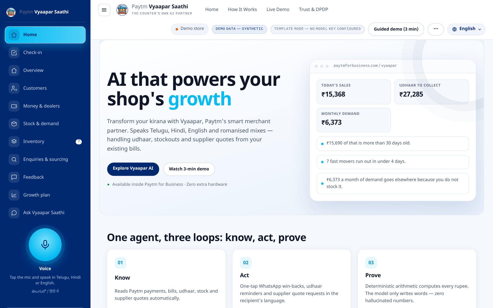
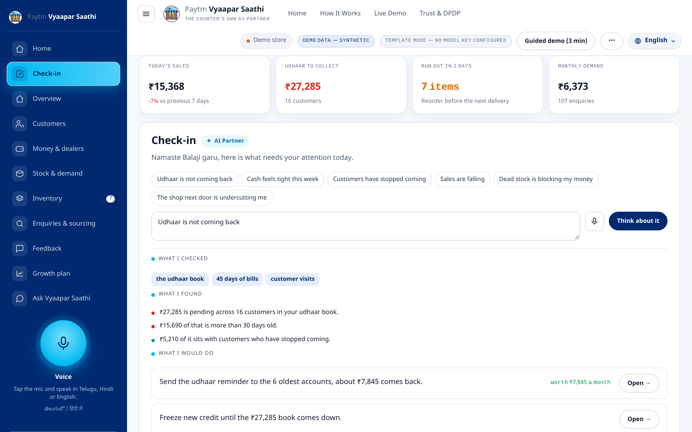
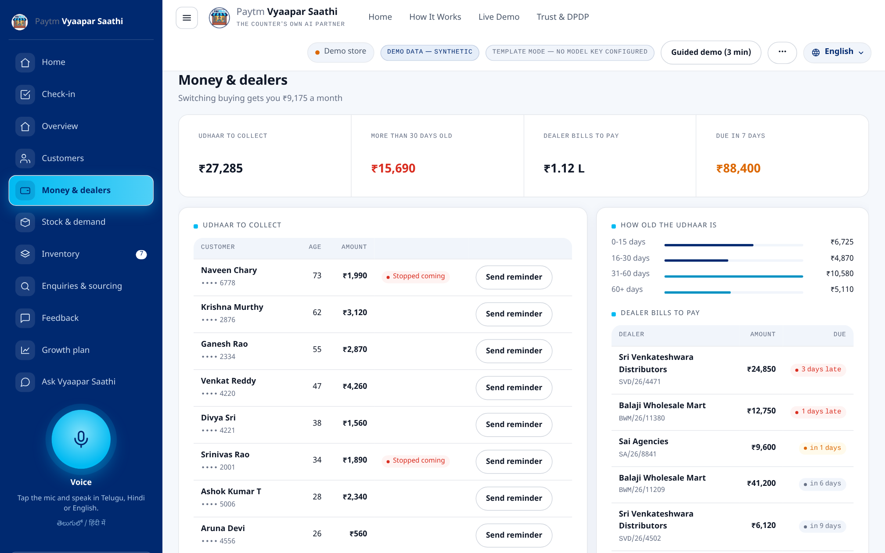
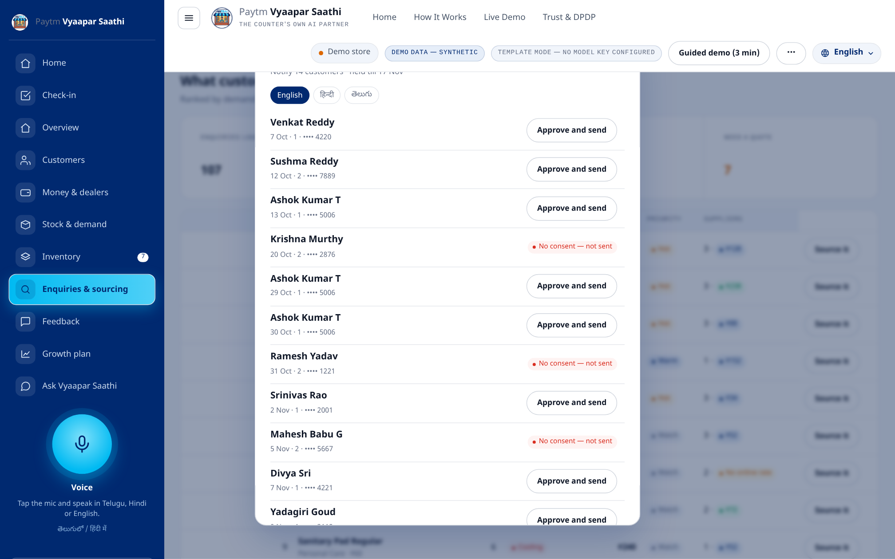

# Paytm Vyaapar Saathi

**The counter's own AI partner — voice-first in Telugu, built on the payments a shop already takes.**

An AI agent for small kirana shops. It reads the shop's payments, udhaar book, stock, dealer quotes and
customer enquiries, then tells the owner what is costing him money and drafts the fix — in Telugu,
Hindi, English, or a romanised mix of all three.

Built for the **Paytm Build for India AI Hackathon · Track 1, Merchant AI**.



---

## The idea in one line

The owner never has to remember what is running out, who has stopped coming, or what a customer asked
for three weeks ago. The agent remembers, and puts the next action one tap away.

## What it does

| Screen | What it does for the owner |
|---|---|
| **Home** | The product in one screen — the pitch, the live figures and the way in. |
| **Check-in** | He says what is worrying him today, by voice or text; the agent answers with what it checked, what it found, and what to do. |
| **Overview** | Today's takings, the week against the last, and the three things costing him money right now. |
| **Customers** | Who has stopped coming, who is drifting, and a win-back message already written in their language. |
| **Money & dealers** | Udhaar aged by how old it is, dealer bills with due dates, and which supplier gives the better rate. |
| **Stock & demand** | Slow movers holding his cash, and what to reorder before it runs out. |
| **Inventory** | What is on the shelf, how fast it moves, and how many days of cover are left. |
| **Enquiries & sourcing** | Every request for something he doesn't stock, ranked by rupee value, matched to the suppliers who carry it. |
| **Feedback** | What customers are actually saying, grouped into themes, each with a fix attached. |
| **Growth plan** | Six actions ranked by rupees, not by opinion. |
| **Ask Vyaapar Saathi** | Free-text or voice questions answered from his own bills. |

<p align="center">
  
  
</p>

## The moment worth seeing

A customer asks for something the shop doesn't stock. The request is logged against that customer,
ranked by rupee value, and matched to suppliers. When stock arrives, every waiting customer is
messaged — in their language, with the date they asked and a short hold.

<p align="center"></p>

## Run it

**Windows** — double-click `start.bat`. It tries `py`, then `python`, then `python3`, and falls back to
a PowerShell server that needs no Python at all.

**macOS / Linux**

```bash
python3 start.py
```

Either way a browser tab opens at **http://localhost:8000/Paytm_Vyaapar_Saathi.html**.

> That address matters: browsers give the microphone only to `https://` and `http://localhost`, and
> only to a top-level page. Opened from a file path, a LAN IP, or an embedded preview pane, the mic is
> refused before the page can ask. The app detects this and says so.

No keys are needed for anything except Sarvam voice.

## Voice

Two paths, in order:

1. **Sarvam, through a local proxy** — record the audio, send it to `voice_server.py`, transcribe with
   `saaras:v4`, speak with `bulbul:v3`. Does not depend on the browser's speech service at all.
2. **Browser recogniser** — automatic fallback when no proxy is running.

```bash
export SARVAM_API_KEY=sk_...      # Windows: set SARVAM_API_KEY=sk_...
python3 voice_server.py           # http://localhost:8787
```

The page probes `http://localhost:8787/health` at boot. If it answers, voice switches to Sarvam; if
not, the browser engine takes over, and if that is unavailable the app offers typed input instead.
Keys never enter the client.

## Architecture

```
 synthetic demo shop  ──►  deterministic engine (JS)  ──►  agent  ──►  UI · WhatsApp · voice
 bills · udhaar · stock      churn · cover · aging            intent +     9 screens
 dealers · enquiries         ranking · best-deal              pain-point    3 languages
 feedback · consent          number verification              diagnosis     consent gates
```

**The LLM writes words. The engine computes every number.** Any figure in a generated message is
checked against the engine's own value; a mismatch throws the draft away and falls back to a template.

## What is real, what is simulated, what is next

| | Status |
|---|---|
| Analytics — churn, days of cover, udhaar aging, enquiry ranking, dealer cost | **Real**, deterministic, 83 tests |
| Consent, masking, audit log, opt-out, withdraw/delete/export | **Real**, working in the prototype |
| Send gates — consent, 9am–7pm window, weekly cap, owner approval | **Real**, enforced in code |
| Number verification on generated text | **Real**, tested |
| Voice in and out | **Real** — Sarvam through the proxy, browser engine as fallback |
| Shop data | **Synthetic.** One generated demo shop, labelled on screen at all times |
| Language-model drafting | **Wired, not enabled** — no key configured, so every draft is a template |
| WhatsApp / SMS sending | **Composed, one tap from send.** Needs the Business API or a DLT sender |
| Billing capture, cash reconciliation, credit scoring | **Roadmap** |

## Compliance and trust

Consent is captured **per purpose** — receipt, reminder, stock alert — each with a timestamp and the
language it was given in. Phone numbers are masked everywhere. Reminders obey one per customer per
week, between 9am and 7pm, and stop outright on a dispute or a hardship flag. Every customer-facing
message says it was AI-drafted and waits for the owner's approval. No PIN, card or bank credential is
ever touched; receipts are marked informational, not a GST tax invoice. No keys in the client.

*This describes what the prototype enforces. It is not a compliance certificate — confirm the current
DPDP Act commencement dates and WhatsApp/TRAI template rules before claiming compliance.*

## Tests

```bash
node engine.test.js     # 83 assertions, all passing
```

Covers churn cut-offs, days of cover and category-aware reorder, udhaar aging buckets, enquiry
ranking, dealer effective cost, plan ordering, a 20-phrase golden routing set across
English/Hindi/Telugu/romanised mixes, and number consistency in generated messages.

## Files

| File | What it is |
|---|---|
| `Paytm_Vyaapar_Saathi.html` | The app — one self-contained file |
| `Paytm_Vyaapar_Saathi_Deck.html` | 17-slide pitch deck (arrow keys, `F` full screen, prints to PDF) |
| `start.bat` · `start.ps1` · `start.py` | Launchers — serve on localhost and open a tab |
| `voice_server.py` | Sarvam STT/TTS proxy, standard library only |
| `engine.test.js` | Engine tests |
| `.env.example` | Every key the proxy needs |

## License

MIT — see [LICENSE](LICENSE).

---

*Synthetic demo data throughout. Not affiliated with or endorsed by Paytm; built for their hackathon.*
